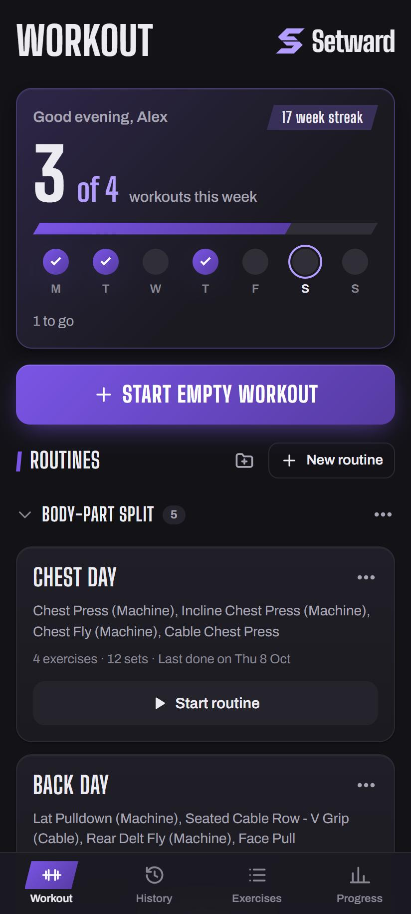
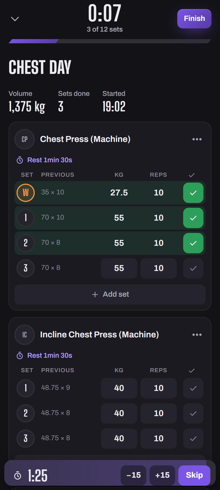
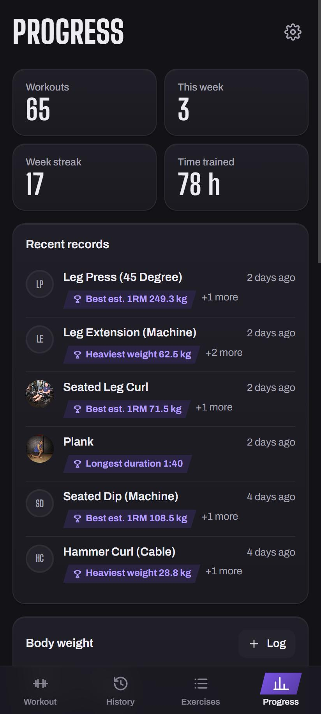
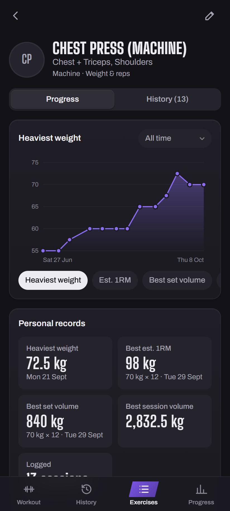

# Setward

**Forward, one set at a time.** A free workout log that runs in your browser, installs to your phone's home screen and works offline. No account, no ads, no tracking. Your workouts stay on your device, with an optional synced copy in your own private GitHub repository.

**Open it: [botrading20-glitch.github.io/chalk](https://botrading20-glitch.github.io/chalk/)**

<p>
  
  
  
  
</p>

## What it does

- **Log workouts.** Sets with weight/reps/time/distance, warm-up, failure and drop sets, RPE, notes and supersets. Your previous numbers show next to every set, and a rest timer (with sounds, and an alert that works with the screen off) starts when you check a set off. Forgot to log a session? Add it afterwards on its own date.
- **Routines and starter programs.** Build routines yourself, save one from any past workout, create them from your history in one tap, or start from one of six starter programs (full body, upper/lower, push/pull/legs, body-part split, machines and cables, dumbbells at home). Group routines in folders and put them in the order you like.
- **1,000+ exercises**, most with pictures and instructions. Add your own in seconds and pick what you log: weight & reps, bodyweight, assisted, time, distance… Edit any library exercise and your history moves to your version.
- **Progress.** Personal records and your latest ones at a glance, a chart for each exercise (heaviest weight, est. 1RM, volume…), weekly time/volume/sets, sets per muscle, a consistency calendar and body-weight tracking. A weekly goal and streak on Home.
- **Share.** Turn any workout into a summary image with your records, ready for the share sheet.
- **Plate calculator.** What goes on each side of the bar (or a plate-loaded machine) for any weight, using the plates your gym has.
- **Import and export.** Bring in your history from a Strong CSV export, export everything as Setward's own CSV, and back up or restore everything as JSON.
- **Cloud sync (optional).** Keeps your data in a private GitHub repository and syncs it between your phone and computer, with the full history of every change.
- **Make it yours.** kg/lbs, km/mi, 12/24-hour time, week start, 1RM formula, dark, light or pure black, four accent colours, text size, high contrast, reduced motion and larger workout controls.

## Languages

English, Français, العربية (right to left), Español, Deutsch, Português (Brasil), Italiano, Türkçe, Nederlands, Polski and Bahasa Indonesia. Pick one in **Settings → Language**, or let it follow your phone.

The translations other than English are **machine-made**, so some wording will be off. If you find something, please [open an issue](https://github.com/botrading20-glitch/chalk/issues/new). Exercise names and instructions come from an English library and stay in English.

## Privacy

There is no Setward account and no Setward server. Workouts, routines and settings are stored on your device. Nothing is sent anywhere unless you turn on cloud sync, and then it goes only to the private GitHub repository you chose. No ads, no analytics, no trackers. Exercise photos load from GitHub's servers when you open an exercise. Read the whole policy in [`public/privacy.html`](public/privacy.html) (live at [/privacy.html](https://botrading20-glitch.github.io/chalk/privacy.html)).

## Install it

- **iPhone (Safari):** Share → Add to Home Screen
- **Android (Chrome):** ⋮ → Install app (or tap Install on the banner)
- **Computer (Chrome, Edge):** the install icon in the address bar

The installed app has its own icon, opens full-screen and works without a connection. Long-press the icon on Android for shortcuts: **Start workout** and **Log body weight**.

On iPhone, Safari can erase the data of websites that aren't on the home screen, so add Setward to your home screen first, or keep a backup.

## Licence

[MIT](LICENSE). Exercise data: [free-exercise-db](https://github.com/yuhonas/free-exercise-db) (public domain). Fonts: Big Shoulders Display, Archivo and Noto Sans Arabic under the SIL Open Font Licence, through [Fontsource](https://fontsource.org). Built with React, Dexie and Vite.

---

# For developers

## Run it on your computer

Requires [Node.js](https://nodejs.org) 20.19+ (free).

```bash
npm install
npm run dev
```

Open http://localhost:5173. To try it on your phone, connect it to the same Wi-Fi and open the "Network" address Vite prints. Installing to the home screen and offline mode only work over HTTPS, so use the deployed version for real training (see below).

## Put it on your phone (free)

The app is a set of static files, so any free static host works. GitHub Pages is the simplest:

1. Create a free GitHub account and a **public** repository (on the free plan, Pages only serves public repos; the code has no personal data in it).
2. Push this folder to the repository's `main` branch.
3. In the repository, go to **Settings → Pages** and set **Source** to **GitHub Actions**. The included workflow builds and publishes the app on every push.
4. On your phone, open `https://<your-username>.github.io/<repo-name>/`:
   - **iPhone (Safari):** Share → Add to Home Screen
   - **Android (Chrome):** ⋮ → Install app / Add to Home screen

Cloudflare Pages, Netlify and Vercel are free alternatives that also allow private repositories. Use build command `npm run build` and output folder `dist`.

## Your data

Workouts are stored in the browser's IndexedDB on the device you log them on. The app works fully offline and needs no account.

Setward was previously called Chalk. Existing workouts, sync repositories and Chalk backups remain compatible. The deployed app stays at the same `/chalk/` address so installed copies and local data keep working.

To keep a copy off the device, turn on **cloud sync**, or use **Settings → Back up data** now and then. **Restore backup** brings a backup file back on any device. If a damaged record ever stops Setward from opening, the recovery screen has **Check for damaged data**, which lists what it cannot read and lets you repair or delete each item (**Settings → Check data for problems** does the same).

### Cloud sync (free)

Setward syncs to a **private GitHub repository** that you own. There's no Setward server in between.

1. Create a private repository, for example `setward-data`: [github.com/new](https://github.com/new?name=setward-data&visibility=private).
2. Create a fine-grained access token at [github.com/settings/personal-access-tokens/new](https://github.com/settings/personal-access-tokens/new):
   - **Repository access:** Only select repositories → your data repository
   - **Permissions → Contents:** Read and write
   - **Expiration:** as long as you like. When it expires, Setward asks for a new one.
3. In Setward, open **Progress → ⚙ Settings → Cloud sync → Set up sync** and paste the repository (`yourname/setward-data`) and the token. Do this on each device.

When a second device already has data, Setward asks whether to replace it with the cloud copy or merge the two. Merging recognises workouts imported from a CSV on both devices and keeps them once.

After that, sync runs by itself:
- when the app opens or comes back to the foreground
- a few seconds after you save or edit anything
- when you go back online

**Settings → Sync now** forces one.

- **How it syncs:** changes are merged record by record. If the same workout was edited on two devices before they synced, the newest edit wins. If it was edited on one and deleted on the other, the edit is kept.
- **History:** every sync is a commit, so the repository's history holds every earlier version of your data.
- **The token:** it's stored in the app's storage on each device and only sent to `api.github.com`. Keep the repository private; Setward refuses to connect to a public one.
- **Different addresses:** data belongs to the address you opened the app from, so `localhost` and your GitHub Pages address are separate. Sync or a backup moves data between them.

To import from Strong: export your data as CSV in Strong, then in Setward go to **Progress → ⚙ Settings → Import workouts (CSV)**. If the file doesn't say whether its weights are kg or lbs, Setward asks.

## Project layout

```
scripts/build-exercises.mjs   regenerates src/data/exercises.json (npm run exercises)
scripts/sample-backup.mjs     writes a sample backup to restore in a dev browser for testing
src/db.ts                     IndexedDB schema (Dexie) and exercise library seeding
src/lib/                      stats & records, CSV import/export, backups, cloud sync, routing, formatting
src/components/               workout editor, exercise picker, charts, sheets
src/pages/                    one file per screen
src/i18n/                     the typed English catalog (en/) and the ten translations, loaded on demand
public/privacy.html           the privacy policy; public/store/ has the install-prompt screenshots
branding/store/               store listing assets: feature graphic, listing text, Play Store notes live in .ai/PLAY_STORE.md
```

A new user-facing string goes into `src/i18n/en/*.ts` first and then into all ten language folders, or the type check fails. `npm test` checks every language for the same keys, placeholders and plural forms.

Set `SITE_URL` (with a trailing slash) when building for another address, so the link-preview tags point at it. It defaults to the live site.

Exercise library: [free-exercise-db](https://github.com/yuhonas/free-exercise-db) (public domain), plus a curated list of machine and cable exercises.
